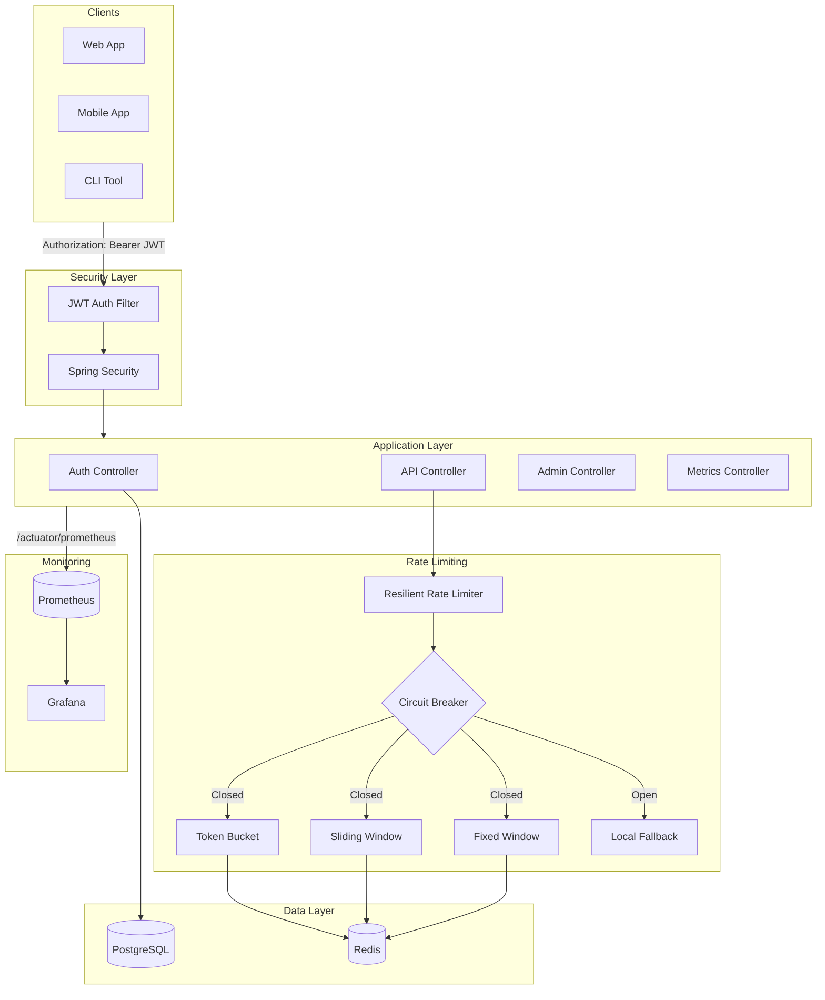
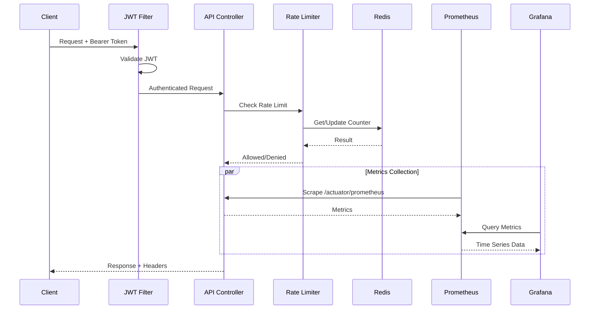
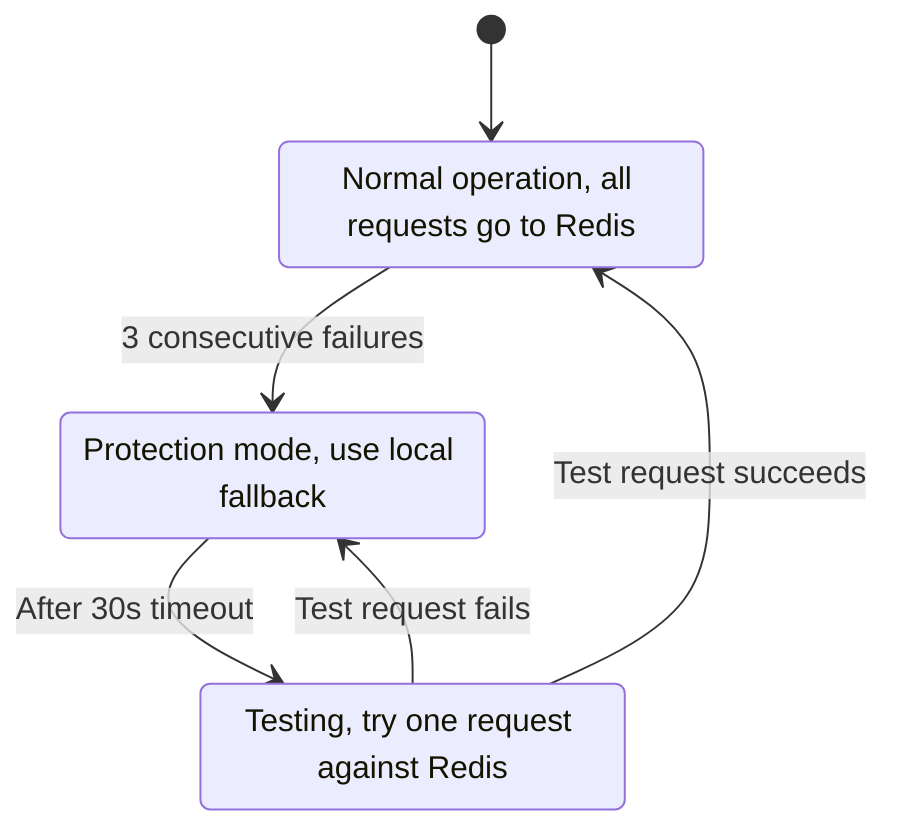

# RateLimitX

A distributed rate limiting service built with Spring Boot, Redis and PostgreSQL. It provides
JWT authentication with per-role rate limits, three rate limiting algorithms backed by Redis,
a circuit breaker with an in-memory fallback, and Prometheus/Grafana monitoring.


## Table of Contents

- [Overview](#overview)
- [Features](#features)
- [Architecture](#architecture)
- [Authentication](#authentication)
- [Algorithms](#algorithms)
- [Monitoring](#monitoring)
- [Circuit Breaker](#circuit-breaker)
- [Tech Stack](#tech-stack)
- [Getting Started](#getting-started)
- [Docker Deployment](#docker-deployment)
- [API Documentation](#api-documentation)
- [Benchmarks](#benchmarks)
- [Project Structure](#project-structure)

---

## Overview

RateLimitX protects APIs from abuse and enforces fair resource allocation. It offers JWT-based
authentication with role-based rate limits, three rate limiting algorithms implemented on Redis,
Prometheus/Grafana monitoring, and a circuit breaker that falls back to an in-memory limiter when
Redis is unavailable. The whole stack runs under Docker Compose.

### Why Rate Limiting?

- **Prevent abuse**: stop a single client from overwhelming the API
- **Ensure fairness**: allocate capacity by user tier (USER / PREMIUM / ADMIN)
- **Protect infrastructure**: reduce the blast radius of traffic spikes
- **Cost control**: cap expensive operations per user

### Key Highlights

- **JWT authentication** — stateless tokens carrying the user's role and rate limit
- **Tiered rate limits** — USER (10), PREMIUM (100), ADMIN (1000) requests/min by default
- **Three Redis algorithms** — fixed window, token bucket, sliding window counter
- **Circuit breaker fallback** — in-memory limiting while Redis is unreachable, with a single
  recovery probe and failure counting restricted to Redis outages
- **No default secrets** — the application refuses to start without a 32-byte `JWT_SECRET`
- **Login throttling** — `/auth/login` and `/auth/register` capped per client IP
- **Prometheus + Grafana** — metrics on a private management port, auto-provisioned dashboard
- **Docker Compose** — 5 services: app, PostgreSQL, Redis, Prometheus, Grafana

Benchmarks: pending, see [docs/benchmarks.md](docs/benchmarks.md).

---

## Features

### Authentication & Security
- JWT authentication — stateless token-based authentication
- BCrypt password hashing
- Role-based access control — USER, PREMIUM, ADMIN
- Tiered rate limits per role
- Spring Security 7
- No secret has a default value; a missing or short `JWT_SECRET` aborts startup
- `/auth/login` and `/auth/register` are throttled per client IP (5/min each by default)
- All errors are JSON: 401 unauthenticated, 403 unauthorised, 400 validation, 404 unknown
- Actuator is served on a private port that Docker Compose does not publish

### Rate Limiting Algorithms
- Fixed window counter — simple time-window based limiting
- Token bucket — smooth limiting with burst support
- Sliding window counter — no window-boundary burst
- Every decision is a single atomic Lua script, so concurrent requests cannot both pass
- Window and refill arithmetic use Redis's clock, so instances cannot disagree about the time
- Capacity and refill rate follow the caller's tier, not a fixed default
- Keys carry a hash tag per user, so a Redis Cluster keeps one user's keys on one node
- The algorithm can be switched at runtime via `POST /admin/algorithm`

### Monitoring & Observability
- Prometheus metrics exposed at `/actuator/prometheus`
- Grafana dashboard provisioned on startup
- Custom metrics for request counts, denials and rate limit check duration
- JVM metrics (memory, CPU, threads) collected by Micrometer

### Reliability
- Circuit breaker around the Redis-backed limiters
- In-memory fallback limiter while the circuit is open
- Automatic recovery once Redis responds again
- Health endpoints for the application and the circuit breaker

### Operations
- Docker and Docker Compose
- 5 orchestrated services: app, PostgreSQL, Redis, Prometheus, Grafana
- Gatling load-test harness (see [Benchmarks](#benchmarks))

### API Headers
```
X-RateLimit-Limit: 10          # Maximum requests allowed
X-RateLimit-Remaining: 7       # Requests remaining in window
X-RateLimit-Reset: 45000       # Time until the limit resets
X-Algorithm: sliding-window    # Active algorithm
X-User-Role: PREMIUM           # User's role/tier
Retry-After: 45                # Seconds before the client should retry (on 429)
```

`X-RateLimit-Reset` is milliseconds for every algorithm, and `X-RateLimit-Limit` reports the
limit the limiter actually enforced. `Retry-After` is whole seconds, rounded up, never below 1.

---

## Architecture



### Request Flow



---

## Authentication

RateLimitX uses JWT for stateless authentication with role-based rate limiting.

### User Roles & Rate Limits

| Role | Default rate limit | Access |
|------|--------------------|--------|
| **USER** | 10 req/min | `/api/**`, `/auth/**`, `/metrics/**` |
| **PREMIUM** | 100 req/min | `/api/**`, `/auth/**`, `/metrics/**` |
| **ADMIN** | 1000 req/min | All endpoints including `/admin/**` |

Defaults come from `ratelimit.default.user`, `ratelimit.default.premium` and
`ratelimit.default.admin`; a per-user override is stored on the user row.

### JWT Claims

The token is signed with HMAC-SHA256 and carries the subject (username), the user's `role`
and their `rateLimit`, plus the standard `iat` and `exp` claims.

### Security Settings

| Setting | Implementation |
|---------|----------------|
| Password hashing | BCrypt (Spring Security default strength, 10) |
| Token signing | HMAC-SHA256 |
| Token expiry | 24 hours (`jwt.expiration=86400000`, milliseconds) |
| Session management | Stateless |
| CSRF protection | Disabled (stateless API) |

---

## Algorithms

### 1. Fixed Window Counter

Counts requests in fixed time windows (for example, per minute).

| Pros | Cons |
|------|------|
| Simple to implement | Boundary burst problem |
| Low memory usage | Can allow 2x limit at window edges |
| O(1) operations | Hard reset may surprise clients |

**Best for**: simple APIs, internal services

### 2. Token Bucket

Tokens are added at a fixed rate; each request consumes a token. Capacity is the caller's
per-minute limit and the refill rate is that limit divided by 60 seconds, so a tier allowed 100
requests a minute can burst to 100 and then sustain 100 a minute.

| Pros | Cons |
|------|------|
| Allows controlled bursts | More state to keep |
| Smooth rate limiting | Requires tuning |
| Widely used in practice | Two parameters to configure |

**Best for**: public APIs, services needing burst capacity

### 3. Sliding Window Counter

Combines the current and previous window with a weighted average.

| Pros | Cons |
|------|------|
| No boundary burst | Slightly more complex |
| More accurate than a fixed window | Multiple Redis keys per user |
| Smoother client experience | More memory usage |

**Best for**: high-accuracy limits, premium tiers

---

## Monitoring

RateLimitX ships with a Prometheus and Grafana stack.

### Metrics Exposed

| Metric | Type | Description |
|--------|------|-------------|
| `http_server_requests_seconds` | Histogram | HTTP request latencies |
| `ratelimit_requests_total` | Counter | Total rate limit checks |
| `ratelimit_requests_denied` | Counter | Denied requests, tagged by algorithm |
| `ratelimit_check_duration` | Timer | Rate limit check duration |
| `app_circuitbreaker_state` | Gauge | Circuit breaker state: 0=CLOSED, 1=HALF_OPEN, 2=OPEN |
| `jvm_memory_used_bytes` | Gauge | JVM memory usage |
| `jvm_threads_current` | Gauge | Active threads |

No metric carries a per-user label: one time series per user would grow without bound. Per-user
counts come from `/metrics/user/{userId}` instead.

See [MONITORING-SETUP.md](MONITORING-SETUP.md) for the full setup and example PromQL queries.

### Access URLs

| Service | URL | Credentials |
|---------|-----|-------------|
| Application | http://localhost:8080 | JWT |
| Prometheus | http://127.0.0.1:9090 | - |
| Grafana | http://127.0.0.1:3000 | `GRAFANA_ADMIN_USER` / `GRAFANA_ADMIN_PASSWORD` from `.env` |

Prometheus, Grafana, PostgreSQL and Redis publish their host ports on `127.0.0.1` only, so they
are not reachable from other machines on the network. Only the application's port 8080 is bound
on all interfaces.

### Actuator

Actuator runs on its own port (`management.server.port=9091`) which Docker Compose does not
publish. Prometheus scrapes `app:9091` across the internal network; nothing under `/actuator` is
mapped on port 8080 at all.

This was chosen over keeping actuator on port 8080 behind an ADMIN role check. Prometheus would
then need credentials to scrape, and a single mistake in a request matcher would expose health
details, `/actuator/env` or the metrics endpoint publicly. An unpublished port cannot be reached
from outside the Compose network however the authorization rules are written.

The cost is that `curl http://localhost:8080/actuator/health` no longer works from the host. Check
health instead with:

```bash
docker compose ps
```

```bash
docker exec ratelimitx-app curl -fsS http://localhost:9091/actuator/health
```

---

## Circuit Breaker

A circuit breaker wraps the Redis-backed limiters so the service keeps answering when Redis
is unreachable.



| Parameter | Property | Default |
|-----------|----------|---------|
| Failure threshold | `ratelimit.circuit-breaker.failure-threshold` | 3 |
| Timeout before probing | `ratelimit.circuit-breaker.timeout` | 30s |
| Fallback window | `ratelimit.fallback.window-size-ms` | 60000 |
| Fallback counter eviction | `ratelimit.fallback.eviction-after-ms` | 300000 |

Behaviour worth knowing before relying on it:

- **Only one probe runs at a time.** In HALF_OPEN a single request is allowed through to Redis;
  every other request in that moment uses the fallback. Reopening the gate to all traffic at once
  would send the full arriving load at a dependency that was failing seconds earlier.
- **Only Redis connectivity and timeout failures open the circuit.** Any other exception
  propagates to the caller rather than being counted and hidden behind the fallback, so a bug in
  the limiter surfaces as an error instead of as a silent downgrade.
- **Fallback limits are per instance.** N instances serving the fallback simultaneously admit up
  to N x limit per window between them. During an outage the service keeps answering with an
  approximate limit rather than failing; treat fallback numbers accordingly.
- `app_circuitbreaker_state` reports the live state: 0 CLOSED, 1 HALF_OPEN, 2 OPEN.

---

## Tech Stack

| Component | Technology | Purpose |
|-----------|------------|---------|
| Language | Java 21 | Core application |
| Framework | Spring Boot 4.0.0 | REST API, dependency injection |
| Security | Spring Security 7.0.0 | Authentication & authorization |
| Authentication | JWT (jjwt 0.12.3) | Stateless token-based auth |
| Database | PostgreSQL 16 | User management & persistence |
| Cache | Redis 7.x | Distributed rate limit storage |
| Metrics | Micrometer + Prometheus | Metrics collection |
| Visualization | Grafana 10.1 | Dashboards |
| ORM | Spring Data JPA (Hibernate 7) | Database access |
| Scripting | Lua | Atomic rate limit decisions, with Redis as the time source |
| Containerization | Docker & Docker Compose | Deployment |
| Load testing | Gatling 3.10 | Performance measurement |
| Build | Maven | Build & dependency management |

---

## Getting Started

### Prerequisites

- Docker and Docker Compose
- For local (non-Docker) runs: JDK 21 and a running Redis and PostgreSQL

### Quick Start with Docker

```bash
git clone https://github.com/Rugved-142/RateLimitX.git
cd RateLimitX
```

```bash
cp .env.example .env
```

Edit `.env` and replace every `replace_me_*` value. `JWT_SECRET` must be at least 32 bytes or the
application will not start; generate one with `openssl rand -base64 48`. `SPRING_DATASOURCE_PASSWORD`
must match `POSTGRES_PASSWORD`. Then start the five services:

```bash
docker compose up --build
```

```bash
docker compose ps
```

The `app` service reports `healthy` once its container healthcheck passes. Grafana is at
http://127.0.0.1:3000 and Prometheus at http://127.0.0.1:9090.

### Building and Testing Locally

```bash
./mvnw -B verify
```

For local debugging, the `dev` profile turns on SQL logging and debug logging for the rate
limiting internals. It is never active by default:

```bash
SPRING_PROFILES_ACTIVE=dev ./mvnw spring-boot:run
```

---

## Docker Deployment

### Services

| Service | Container | Port |
|---------|-----------|------|
| app | ratelimitx-app | 8080 |
| postgres | ratelimitx-postgres | 5432 |
| redis | ratelimitx-redis | 6379 |
| prometheus | ratelimitx-prometheus | 9090 |
| grafana | ratelimitx-grafana | 3000 |

All services share the `ratelimitx-network` bridge network. Persistent volumes:
`postgres-data`, `redis-data`, `prometheus-data`, `grafana-data`.

### Docker Commands

```bash
docker compose up --build
```

```bash
docker compose up -d
```

```bash
docker compose logs -f app
```

```bash
docker compose down
```

```bash
docker compose down -v
```

```bash
docker exec -it ratelimitx-redis redis-cli
```

---

## API Documentation

### Authentication Endpoints

#### Register User
```http
POST /auth/register
Content-Type: application/json

{
  "username": "rugved",
  "email": "rugved@example.com",
  "password": "password123"
}
```

#### Login
```http
POST /auth/login
Content-Type: application/json

{
  "username": "rugved",
  "password": "password123"
}
```

**Response:**
```json
{
  "token": "eyJhbGciOiJIUzI1NiJ9...",
  "tokenType": "Bearer",
  "expiresIn": 86400,
  "username": "rugved",
  "role": "USER",
  "rateLimit": 10
}
```

#### Current User
```http
GET /auth/me
Authorization: Bearer <token>
```

---

### Rate Limited Endpoints

#### Get Data
```http
GET /api/data
Authorization: Bearer <token>
```

**Response headers:**
```
X-RateLimit-Limit: 10
X-RateLimit-Remaining: 7
X-RateLimit-Reset: 45000
X-Algorithm: sliding-window
X-User-Role: USER
```


#### Rate Limit Status
```http
GET /api/status
Authorization: Bearer <token>
```

---

### Metrics Endpoints

`/metrics/**` is backed by Redis counters and is **disabled by default**, because recording them
costs roughly fourteen extra Redis commands on every request for numbers Micrometer already
provides. These paths return 404 unless `metrics.legacy.enabled=true`. Prometheus metrics at
`/actuator/prometheus` are unaffected by this setting.

```http
GET /metrics/summary
GET /metrics/hourly
GET /metrics/daily
GET /metrics/history?hours=24
GET /metrics/user/{userId}
```

---

### Admin Endpoints (ADMIN role)

```http
GET    /admin/health
GET    /admin/stats
GET    /admin/algorithm
POST   /admin/algorithm
GET    /admin/user/{userId}
GET    /admin/bucket/{userId}
GET    /admin/sliding/{userId}
GET    /admin/compare/{userId}
POST   /admin/limit
DELETE /admin/reset/{userId}
GET    /admin/circuit
POST   /admin/circuit/reset
```

---

#### Switch algorithm at runtime

```http
POST /admin/algorithm
Authorization: Bearer <admin token>
Content-Type: application/json

{"algorithm": "token-bucket"}
```

Accepts `fixed-window`, `token-bucket` or `sliding-window`; anything else returns 400 and changes
nothing. Each algorithm keeps its own Redis keys, so switching does not reset anyone's counters.

### Monitoring Endpoints

Served on the management port (9091), which is not published to the host. See
[Actuator](#actuator).

```http
GET /actuator/health
GET /actuator/info
GET /actuator/prometheus
```

---

## Benchmarks

Benchmarks: pending, see [docs/benchmarks.md](docs/benchmarks.md).

The Gatling simulations under `src/test/scala/loadtest/` are not currently usable against the
JWT-protected API, and no reproducible measurement run is committed yet. No latency,
throughput or availability figures are published until one is.

---

## Project Structure

```
RateLimitX/
├── Dockerfile                              # Multi-stage build
├── docker-compose.yml                      # 5 services
├── pom.xml                                 # Maven build
│
├── docs/
│   └── benchmarks.md                       # Measurement results (pending)
│
├── prometheus/
│   └── prometheus.yml                      # Prometheus configuration
│
├── grafana/
│   ├── provisioning/
│   │   ├── datasources/datasource.yml      # Prometheus datasource
│   │   └── dashboards/dashboard.yml        # Dashboard provisioning
│   └── dashboards/
│       └── ratelimitx-dashboard.json       # Pre-built dashboard
│
├── src/main/java/com/ratelimitx/core/
│   ├── RateLimitXApplication.java          # Main entry point
│   │
│   ├── config/
│   │   ├── RateLimitConfig.java            # Rate limit configuration
│   │   ├── AuthThrottleProperties.java     # Per-IP auth endpoint limits
│   │   ├── JwtProperties.java              # JWT secret, validated at startup
│   │   ├── RedisConfig.java                # Redis connection setup
│   │   └── MetricsConfig.java              # Micrometer/Prometheus config
│   │
│   ├── controller/
│   │   ├── ApiController.java              # Rate-limited API endpoints
│   │   ├── AdminController.java            # Admin & monitoring
│   │   ├── AuthController.java             # Authentication endpoints
│   │   └── MetricsController.java          # Redis-based metrics
│   │
│   ├── dto/
│   │   ├── AuthResponse.java
│   │   ├── LoginRequest.java
│   │   └── RegisterRequest.java
│   │
│   ├── entity/
│   │   ├── Role.java                       # User roles enum
│   │   └── User.java                       # User JPA entity
│   │
│   ├── repository/
│   │   └── UserRepository.java
│   │
│   ├── security/
│   │   ├── AuthenticatedUser.java          # Principal carrying id, role, rate limit
│   │   ├── AuthThrottleFilter.java         # Per-IP throttle on /auth/login, /auth/register
│   │   ├── ClientIpResolver.java           # Client IP, X-Forwarded-For opt-in
│   │   ├── CustomUserDetailsService.java
│   │   ├── JwtAuthenticationFilter.java
│   │   ├── JwtUtil.java
│   │   ├── RestAccessDeniedHandler.java    # 403 JSON
│   │   ├── RestAuthenticationEntryPoint.java  # 401 JSON
│   │   └── SecurityConfig.java
│   │
│   ├── circuitbreaker/
│   │   ├── CircuitBreaker.java
│   │   ├── CircuitBreakerState.java
│   │   └── LocalRateLimiter.java           # In-memory fallback
│   │
│   ├── model/
│   │   └── RateLimitResult.java
│   │
│   ├── web/
│   │   ├── GlobalExceptionHandler.java     # JSON error responses
│   │   └── UserNotFoundException.java
│   │
│   └── service/
│       ├── RateLimiterService.java         # Fixed window
│       ├── TokenBucketService.java         # Token bucket
│       ├── SlidingWindowService.java       # Sliding window
│       ├── ResilientRateLimiter.java       # Circuit breaker integration
│       ├── MetricsService.java             # Redis metrics tracking
│       └── PrometheusMetricsService.java   # Prometheus metrics
│
├── src/main/resources/
│   └── application.properties
│
└── src/test/scala/loadtest/
    ├── RateLimitXSimulation.scala          # Gatling simulation
    └── simpleLoadTest.scala
```

---

## Manual Smoke Test

```bash
docker compose up -d
```

```bash
docker compose ps
```

```bash
docker exec ratelimitx-app curl -fsS http://localhost:9091/actuator/health
```

```bash
curl -X POST http://localhost:8080/auth/register -H "Content-Type: application/json" -d '{"username":"testuser","email":"test@example.com","password":"password123"}'
```

Registration and login are limited to 5 requests per minute per client IP; further attempts
return 429 with a `Retry-After` header.

```bash
TOKEN=$(curl -s -X POST http://localhost:8080/auth/login -H "Content-Type: application/json" -d '{"username":"testuser","password":"password123"}' | jq -r '.token')
```

```bash
for i in $(seq 1 15); do curl -s -o /dev/null -w "%{http_code}\n" http://localhost:8080/api/data -H "Authorization: Bearer $TOKEN"; done
```

The first 10 requests return 200 and the rest return 429 for a USER-tier account.

```bash
docker exec ratelimitx-app curl -s http://localhost:9091/actuator/prometheus | grep ratelimit
```

---

## Author

**Rugved Gundawar**

- GitHub: [@Rugved-142](https://github.com/Rugved-142)
- LinkedIn: [Rugved Gundawar](https://www.linkedin.com/in/rugved-gundawar/)

---

## License

This project is licensed under the MIT License - see the [LICENSE](LICENSE) file for details.
