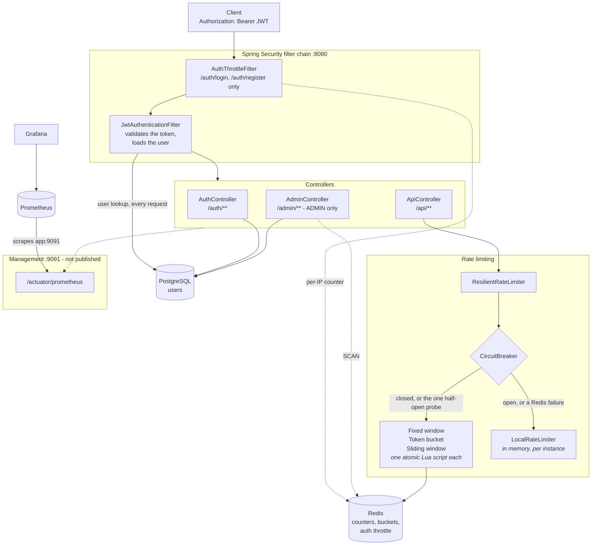

# RateLimitX

A rate limiting service: JWT authentication with per-tier limits, three Redis-backed algorithms,
a circuit breaker with an in-memory fallback, and Prometheus metrics. Runs under Docker Compose
or on Kubernetes.

[](https://github.com/Rugved-142/RatelimitX/actions/workflows/ci.yml)


> The badge tracks the `hardening` branch, which is where this work lives. Point it at `main`
> when it merges.

**Every factual claim below is mapped to the test, script or committed run data that backs it in
[docs/claims.md](docs/claims.md).** No measured figure is quoted in this file: performance and
failure numbers live in generated documents, regenerated from raw data, so that re-running a
benchmark cannot leave a stale number here.

## Contents

- [Quick start](#quick-start) · [What it does](#what-it-does) · [Architecture](#architecture)
- [Algorithms](#algorithms) · [API](#api) · [Operating it](#operating-it)
- [Measured results](#measured-results) · [Design decisions and limitations](#design-decisions-and-limitations)
- [Testing](#testing) · [Continuous integration](#continuous-integration) · [Layout](#layout)

---

## Quick start

From a fresh clone. Needs Docker and Docker Compose; nothing else.

```bash
cp .env.example .env
```

Then edit `.env` and replace every placeholder. There are no defaults: the application refuses to
start without a `JWT_SECRET` of at least 32 bytes, and Compose refuses to start without the
database and Grafana credentials. Generate a secret with:

```bash
openssl rand -base64 48
```

```bash
docker compose up -d --build
```

```bash
scripts/smoke-test.sh
```

The smoke test is the check that the stack works, and it asserts rather than prints: an
unauthenticated request gets 401 and not 403, a forged token is refused, the management port is
**not** reachable from the host, registration and login work, a new USER-tier account gets
exactly 10 admissions and 5 denials out of 15 requests with a usable `Retry-After`, the rate limit
headers are all present, a USER cannot reach `/admin`, and the metrics the dashboards and alert
rules are built on exist. It exits non-zero if any of that is untrue.

Grafana is on http://127.0.0.1:3000 and Prometheus on http://127.0.0.1:9090. Every published port
binds to 127.0.0.1, including the API on 8080: nothing here is meant to be reachable from another
machine. Change that deliberately if you need it.

To tear down, including the volumes:

```bash
docker compose down -v
```

### On Kubernetes

```bash
scripts/kind-up.sh
```

Creates a local [kind](https://kind.sigs.k8s.io) cluster, builds and side-loads the image,
generates the Secret into the cluster, applies `k8s/`, and runs the same smoke test against it.
See [docs/kubernetes.md](docs/kubernetes.md).

### Running the tests

```bash
./mvnw -B verify
```

Integration tests start a real Redis and PostgreSQL with Testcontainers, so **Docker must be
running**. `./mvnw -B test` runs the unit tests alone and needs no Docker.

---

## What it does

A caller authenticates with a JWT and gets a per-minute request allowance set by their tier. Every
request to `/api/data` is checked against that allowance by one of three algorithms, all of which
keep their state in Redis so that several application instances share one view of it. The decision
is one atomic Lua script, so two concurrent requests cannot both be allowed past the limit.

| Tier | Default limit |
|------|---------------|
| USER | 10 requests/minute |
| PREMIUM | 100 requests/minute |
| ADMIN | 1000 requests/minute |

A denied request gets 429 with `Retry-After`. An admitted one gets 200. Both carry the rate limit
headers. A 429 is a correct answer, not an error, and nothing in this repository counts it as a
failure.

When Redis stops answering, a circuit breaker opens and an in-memory limiter takes over so the
service keeps responding. That has real consequences for what "the limit" means, which is
[ADR 3](docs/adr/0003-per-instance-fallback.md) and the
[limitations](#design-decisions-and-limitations) below.

---
## Architecture

Five services under Compose: the application, PostgreSQL, Redis, Prometheus and Grafana.



Two things in that diagram are easy to get wrong and are drawn deliberately:

- **`JwtAuthenticationFilter` queries PostgreSQL on every authenticated request**, to load the
  user whose id, role and limit the limiter then uses. The rate limit decision itself touches only
  Redis, but the request as a whole does hit the database. An earlier version of this README and a
  javadoc both implied otherwise.
- **The management port is a separate server.** Prometheus reaches it over the Compose network;
  no published port maps to it. See [ADR 1](docs/adr/0001-actuator-on-a-separate-unpublished-port.md).

---

## Algorithms

All three keep their state in Redis and make each decision in a single `EVAL`, so concurrency
cannot push the count past the limit. Switch at runtime with `POST /admin/algorithm`.

| Algorithm | How it decides | Boundary behaviour |
|-----------|----------------|--------------------|
| `fixed-window` | One counter per user per window, incremented and expired in one script | A caller can use its whole allowance at the end of one window and again at the start of the next |
| `token-bucket` | Capacity is the tier limit, refilled at limit/60 per second | Permits a burst up to capacity, then settles to the steady rate |
| `sliding-window` | Current window plus a weighted share of the previous one | No boundary burst; the default |

Three properties worth stating because they were not true of the original implementation:

- **The clock is Redis's**, read with `redis.call('TIME')` inside the script, so two application
  instances cannot disagree about which window a request falls in.
  [ADR 2](docs/adr/0002-redis-time-as-the-clock.md).
- **Capacity follows the caller's tier.** The token bucket used a hardcoded capacity of 10, so a
  PREMIUM caller was limited as if free while the headers advertised 100.
- **Keys carry a per-user hash tag**, `{sliding:alice}:current`, so a Redis Cluster keeps one
  user's keys in one slot and a multi-key script stays legal.

`X-RateLimit-Reset` is milliseconds for every algorithm. `Retry-After` is whole seconds, rounded
up, never below 1.

---
## API

All responses are JSON. Errors are JSON too: 401 unauthenticated, 403 unauthorised, 400
validation (with a `fields` map), 404 unknown. A bare exception never becomes a 500 with a stack
trace.

### Authentication

`POST /auth/register` — creates a USER-tier account.

```bash
curl -X POST http://127.0.0.1:8080/auth/register \
  -H 'Content-Type: application/json' \
  -d '{"username":"alice","email":"alice@example.com","password":"password123"}'
```

`POST /auth/login` — returns a token.

```bash
curl -X POST http://127.0.0.1:8080/auth/login \
  -H 'Content-Type: application/json' \
  -d '{"username":"alice","password":"password123"}'
```

Both are capped at 5 requests per minute per client IP; further attempts get 429 with
`Retry-After`. `X-Forwarded-For` is trusted only when `ratelimit.auth.trust-forwarded-for` is on,
because a client can forge it.

### The rate limited endpoint

`GET /api/data` — the endpoint the limiter protects.

```bash
curl -i http://127.0.0.1:8080/api/data -H "Authorization: Bearer $TOKEN"
```

```
X-RateLimit-Limit: 10          the limit the limiter actually enforced
X-RateLimit-Remaining: 7
X-RateLimit-Reset: 45000       milliseconds
X-Algorithm: sliding-window    or local-fallback while the breaker is open
X-User-Role: USER
Retry-After: 45                on 429 only; whole seconds, never below 1
```

`GET /api/status` — the caller's own tier, limit and the active algorithm.

### Admin

Everything under `/admin` requires the ADMIN role.

| Endpoint | Does |
|----------|------|
| `GET /admin/stats` | Active users and keys, from a bounded `SCAN`, with a `truncated` flag |
| `GET /admin/user/{username}` | The limit that would actually be enforced for a user |
| `POST /admin/limit` | Sets a user's limit and/or role |
| `DELETE /admin/reset/{username}` | Clears that user's counters across all algorithms |
| `GET /admin/algorithm` | The active algorithm and the accepted names |
| `POST /admin/algorithm` | Switches it; an unknown name is 400 and changes nothing |
| `GET /admin/circuit` | Circuit breaker state, failure count, thresholds |
| `POST /admin/circuit/reset` | Forces the breaker back to CLOSED |
| `GET /admin/health` | Redis reachability, by writing a probe key |

The first ADMIN has to be made directly in the database; no endpoint creates one.

---

## Operating it

### Metrics

Micrometer exports to `/actuator/prometheus` on the management port. The ones worth knowing:

| Metric | Is |
|--------|-----|
| `ratelimit_requests_total{allowed,algorithm}` | Every decision, by outcome and algorithm |
| `ratelimit_requests_denied_total{algorithm}` | Denials |
| `ratelimit_check_duration_seconds{algorithm,result}` | How long a check took |
| `app_circuitbreaker_state` | 0 CLOSED, 1 HALF_OPEN, 2 OPEN |
| `http_server_requests_seconds` | Request latency, with a histogram for percentiles |

None of them carries a per-user label. Tagging by user id would create one time series per user
and grow without bound.

### Alerts

[`prometheus/rules/ratelimitx.rules.yml`](prometheus/rules/ratelimitx.rules.yml) holds seven
rules: the scrape target down, any 5xx, the breaker OPEN, the breaker failing to return to CLOSED,
the local fallback in use, near-total denial, and p95 latency on `/api/data`. Each one records in
a comment where its threshold came from, and two say plainly that they are round numbers chosen
for headroom rather than measured targets.

There is **no Alertmanager** in `docker-compose.yml`, so these fire into Prometheus' own alert
list at http://127.0.0.1:9090/alerts and reach nobody. Routing them is a deployment concern this
repository does not solve.

### Kubernetes

[`k8s/`](k8s) deploys two application replicas behind a Service, with single-replica Redis and
PostgreSQL StatefulSets. [docs/kubernetes.md](docs/kubernetes.md) covers what is deployed, the
decisions behind the probes and the Secret, and what it does not establish.

---

## Measured results

Every number in these documents is generated from committed raw data by a script with its own
tests. None is typed by hand, and anything that could not be read from the data says
"not measured" instead.

| Document | Covers |
|----------|--------|
| [docs/benchmarks.md](docs/benchmarks.md) | Throughput and latency under stepped load, three runs |
| [docs/failure-test.md](docs/failure-test.md) | Redis frozen for 40s under load, single instance |
| [docs/failure-test-kubernetes.md](docs/failure-test-kubernetes.md) | The same, on Kubernetes with two replicas |
| [docs/pod-kill-test.md](docs/pod-kill-test.md) | One of two replicas deleted under load |
| [docs/slo.md](docs/slo.md) | What has been measured, and why no objective is set from it |

Reproduce any of them:

```bash
scripts/benchmark.sh --runs 3 --algorithm sliding-window
```

```bash
scripts/failure-test.sh --platform compose
```

```bash
scripts/pod-kill-test.sh
```

Each script records the machine, the container limits, the Docker and Kubernetes versions, the
load parameters and the commit it ran at, and marks the run if the working tree was dirty.

---
## Design decisions and limitations

Four decisions with real trade-offs have their own records:

| ADR | Decision |
|-----|----------|
| [1](docs/adr/0001-actuator-on-a-separate-unpublished-port.md) | Actuator on a separate port that is not published, rather than ADMIN-gated on the API port |
| [2](docs/adr/0002-redis-time-as-the-clock.md) | The Lua scripts take the clock from Redis, not from the application |
| [3](docs/adr/0003-per-instance-fallback.md) | Fall back to a per-instance in-memory limiter, and accept over-admission |
| [4](docs/adr/0004-readiness-excludes-redis.md) | Keep Redis out of the readiness probe |

### Limitations

These are properties of the system as it stands, not a to-do list.

- **Redis is a single point of failure for correct limits.** One instance, no replication, no
  Sentinel. Its outage does not stop the service, but while it lasts the limits are approximate.
- **During a Redis outage the enforced limit is per instance, not global.** N instances admit up
  to N times the configured rate between them, and a failover hands every caller a fresh window.
  Measured, not estimated: see the failure test and [ADR 3](docs/adr/0003-per-instance-fallback.md).
- **PostgreSQL is a single point of failure for authentication.** It is read on every
  authenticated request. Its outage stops registration, login and the API alike.
- **No availability figure is claimed anywhere.** The measurements here are minutes of synthetic
  load on one developer machine. That cannot support a statement about behaviour over a period,
  and [docs/slo.md](docs/slo.md) sets no objective for the same reason.
- **The benchmark numbers are a floor, not a capacity.** The load generator shared a machine with
  the service, so the two competed for CPU, and the offered rate never reached saturation.
- **One failure mode has been tested:** a Redis that accepts connections and stops answering. A
  Redis that refuses connections, returns errors or loses data has not been.
- **Node failure has not been tested.** The kind cluster has one node.
- **No Alertmanager, no Ingress, no TLS, no NetworkPolicy, no autoscaling.** The resource requests
  and limits in `k8s/` were sized to fit a laptop.
- **The admin scan is bounded and says so.** `GET /admin/stats` walks at most 10,000 keys and
  returns `truncated: true` rather than presenting a capped count as complete.
- **Rate limit state is not durable.** Counters carry a TTL and a Redis restart drops them, which
  costs at most one window.

---

## Testing

`./mvnw -B verify` runs everything: 69 unit tests and 100 integration tests. The integration tests
use Testcontainers, so Docker must be running.

| Suite | Kind | Covers |
|-------|------|--------|
| `CircuitBreakerTest` | unit | State transitions against a hand-moved clock, single-probe behaviour, failure classification |
| `LocalRateLimiterTest` | unit | Atomic admission, rollover under 200 threads, eviction |
| `RateLimitConfigTest` | unit | Algorithm validation and concurrent switching |
| `JwtPropertiesTest` | unit | Startup refuses a missing or short `JWT_SECRET` |
| `RedisTimeoutConfigTest` | unit | The production Redis timeout is unchanged, so the integration tests' relaxed override cannot become the real value |
| `RateLimitAlgorithmIT` | Testcontainers | Exact limits, tier limits and 200-thread concurrency per algorithm |
| `WindowRolloverIT` | Testcontainers | Real waiting over 2-second windows: rollover and token refill |
| `SecurityIT` | Testcontainers + MockMvc | Absent, forged, expired and orphaned tokens; role enforcement; actuator exposure |
| `AuthThrottleIT` | Testcontainers + MockMvc | Per-IP login and register throttling, `Retry-After`, `X-Forwarded-For` handling |
| `ApiRateLimitIT` | Testcontainers + MockMvc | 200-then-429 with correct headers for every tier and algorithm |
| `AdminUserLimitIT` | Testcontainers + MockMvc | `POST /admin/limit` changes the limit actually enforced, measured on `/api/data` |
| `RedisOutageIT` | Testcontainers | Redis paused under load: no 5xx, breaker opens, fallback serves, recovery closes it |
| `RedisReadinessIT` | Testcontainers | A test that leaves Redis paused must not break the next test's setup — the flake that made CI red |

The analysis scripts have their own suite, because a mistake in one of them puts a wrong number in
a document:

```bash
python3 -m pytest scripts -q
```

It covers the report generators, the Kubernetes manifests' invariants, and the consistency of
every hand-written figure in [docs/slo.md](docs/slo.md), [docs/kubernetes.md](docs/kubernetes.md)
and this README against the committed runs.

JaCoCo writes a coverage report to `target/site/jacoco/index.html`. There is no coverage gate.

---

## Continuous integration

[`.github/workflows/ci.yml`](.github/workflows/ci.yml) runs on pushes to `main` and `hardening`,
on pull requests to `main`, and on demand.

| Job | Does |
|-----|------|
| `build` | JDK 21 with a Maven cache, `./mvnw -B verify`, uploads the surefire, failsafe and JaCoCo reports |
| `scripts` | The pytest suite, plus `promtool` over the Prometheus config and alert rules |
| `kubernetes` | Installs kind from a checksum-verified binary, runs `scripts/kind-up.sh`, then the pod kill test under load; fails on a single 5xx or dropped connection |
| `image` | `docker build`, a Trivy report at CRITICAL/HIGH/MEDIUM, and a gate that fails the build on a fixable CRITICAL |

Every action is pinned to a commit SHA rather than a tag, because a tag can be moved to point at
different code. The readable version sits in a trailing comment and Dependabot updates both
together. Dependabot raises weekly updates for Maven dependencies, Docker base images and the
actions, with Spring Boot's modules grouped into one pull request because they are released
together.

A rule file with a typo loads as nothing and its alerts silently never fire, which is worse than
having no rules, so `promtool` parses them on every push.

---

## Layout

```
RateLimitX/
├── src/main/java/com/ratelimitx/core/
│   ├── circuitbreaker/     CircuitBreaker, LocalRateLimiter, failure classification
│   ├── config/             Properties classes, each validating itself at startup
│   ├── controller/         Auth, Api, Admin, Metrics
│   ├── security/           JWT filter, auth throttle, entry point, principal
│   ├── service/            The three algorithms, ResilientRateLimiter, metrics
│   └── web/                Global exception handling
├── src/test/java/          Unit tests and Testcontainers integration tests
├── src/test/scala/         The Gatling simulation
├── k8s/                    Kubernetes manifests; no Secret, by design
├── prometheus/rules/       Alert rules
├── scripts/                Benchmark, failure test, pod kill, smoke test, kind, analysis
└── docs/
    ├── adr/                Architecture decision records
    ├── benchmarks/         Committed raw benchmark data
    ├── failure-tests/      Committed raw failure test data, per platform
    ├── pod-kill-tests/     Committed raw pod kill data
    ├── claims.md           Every factual claim in this README, mapped to its evidence
    ├── kubernetes.md       The Kubernetes deployment
    └── slo.md              What is measured, and why no objective is set
```

---

## Author

**Rugved Gundawar** — [@Rugved-142](https://github.com/Rugved-142) ·
[LinkedIn](https://www.linkedin.com/in/rugved-gundawar/)

## License

MIT. See [LICENSE](LICENSE).
